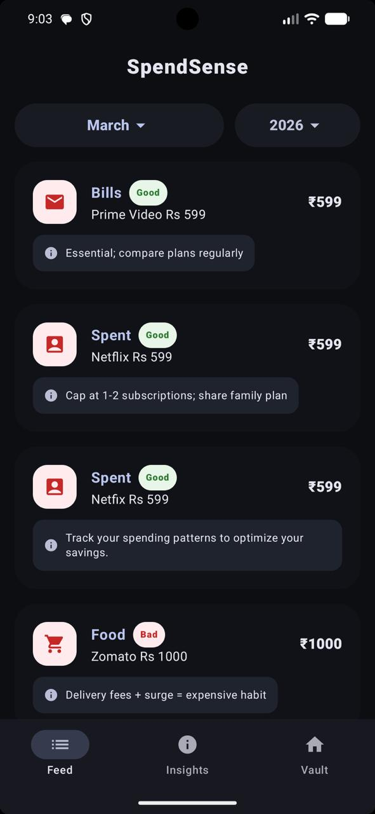
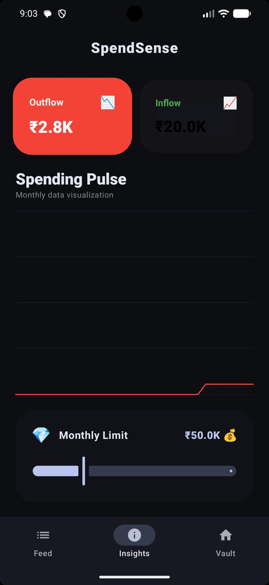
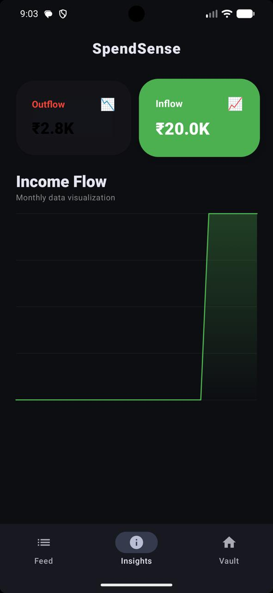
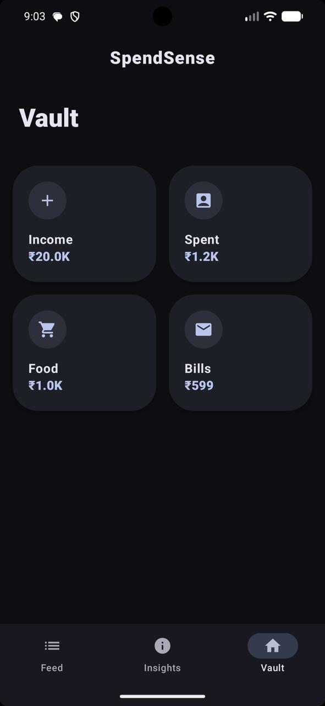
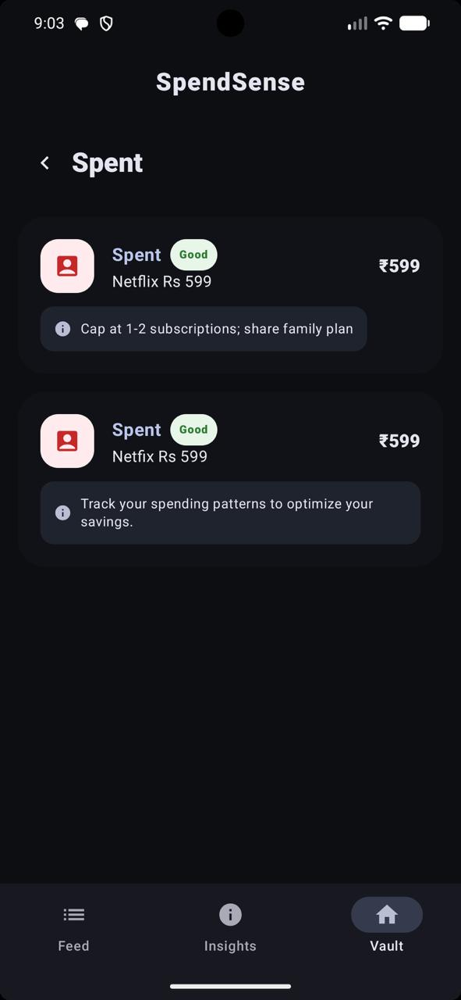

# SpendSense

An Android expense tracker that builds your spending history from bank SMS alerts. Parsing and categorization happen on the phone, and the app has no internet permission.

Built with Kotlin and Jetpack Compose (Material 3). This is an early build: see [Limitations](#limitations).

## Screenshots

| Feed | Insights | Vault |
|------|----------|-------|
|  |  |  |

 

> Match the table headings to your screenshots, or delete the table and keep a simple image row.

## Features

- **SMS capture:** a `BroadcastReceiver` listens for incoming SMS and picks out amounts written as `Rs`, `INR`, `USD` or `$`.
- **Auto-categorization:** keyword matching sorts each transaction into Income, Refund, Food, Travel, Shopping, Bills, Health, Education, Rent or Spent.
- **Spend quality check:** a rule-based analyzer marks a purchase as good, bad or neutral and shows a short suggestion (for example, "Pay on time to avoid penalties").
- **Feed:** transactions for the selected month, with a month switcher.
- **Insights:** income vs. spending totals, an editable monthly budget and a cumulative spending chart.
- **Vault:** spending grouped by category.

## How it works

1. The app asks for `RECEIVE_SMS` and `READ_SMS` permission on first launch.
2. `SmsReceiver` gets each incoming message and a regex pulls out the amount and currency.
3. `ExpenseRepository.categorize()` assigns a category from keyword lists.
4. `ExpenseRepository.analyzeSpend()` adds the good/bad flag and suggestion.
5. The expense is added to the list the Compose screens read from.

## Project structure

```
app/src/main/java/com/example/myapplication/
├── MainActivity.kt   # Compose UI, view model, categorizer and spend analyzer
├── SmsReceiver.kt    # SMS broadcast receiver and amount parser
└── ui/theme/         # Colors, typography, theme
```

## Run it

**Requirements:** a recent Android Studio (the project uses Android Gradle Plugin 9.0.1 and Gradle 9.2.1), an emulator or phone running Android 7.0 (API 24) or newer.

1. Clone the repo and open it in Android Studio.
2. Let Gradle sync, then run the `app` configuration.
3. Tap **Grant Permission** when asked.
4. To test without waiting for a real bank SMS, send one to an emulator from the extended controls (⋯ → Phone → SMS), for example:
   `Rs 450.00 debited at Swiggy`

## Limitations

- Expenses are kept in memory only, so they are lost when the app is closed. Adding a Room database is the next step.
- Only SMS received after permission is granted are captured. Existing messages are not imported.
- Categorization is keyword-based, so unfamiliar merchants fall into "Spent".
- Tested on a limited set of bank message formats.

## Author

Karthik Ganesan
